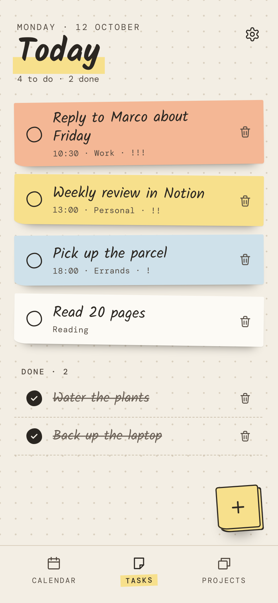
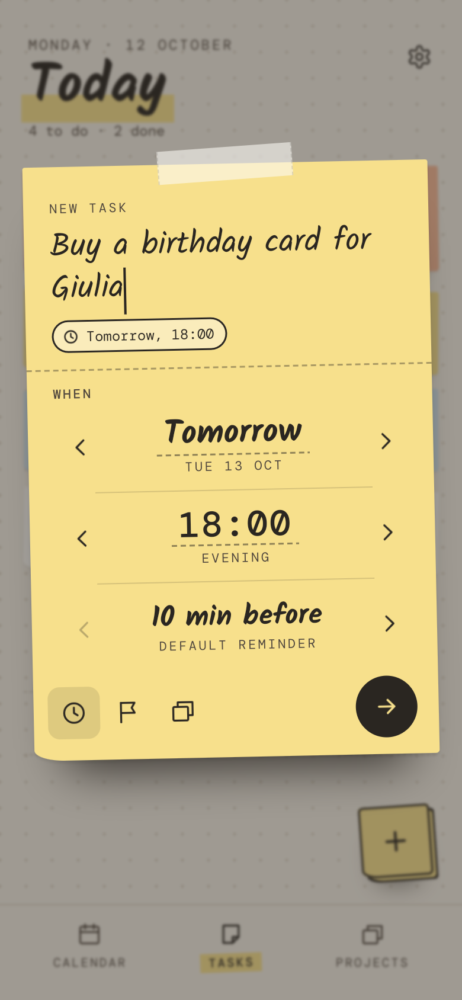
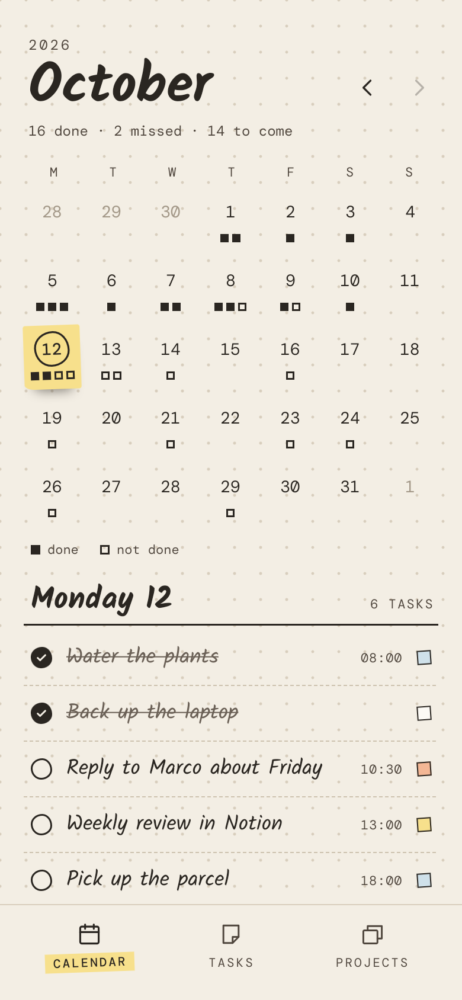
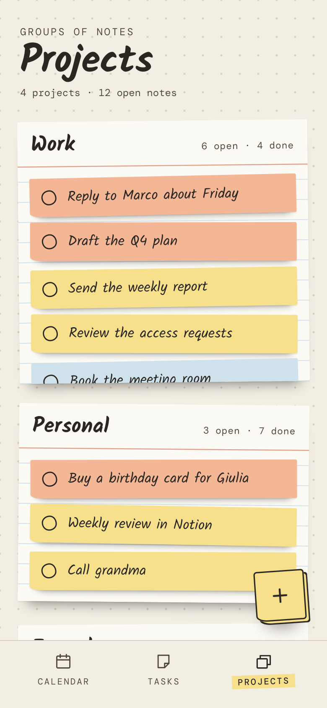
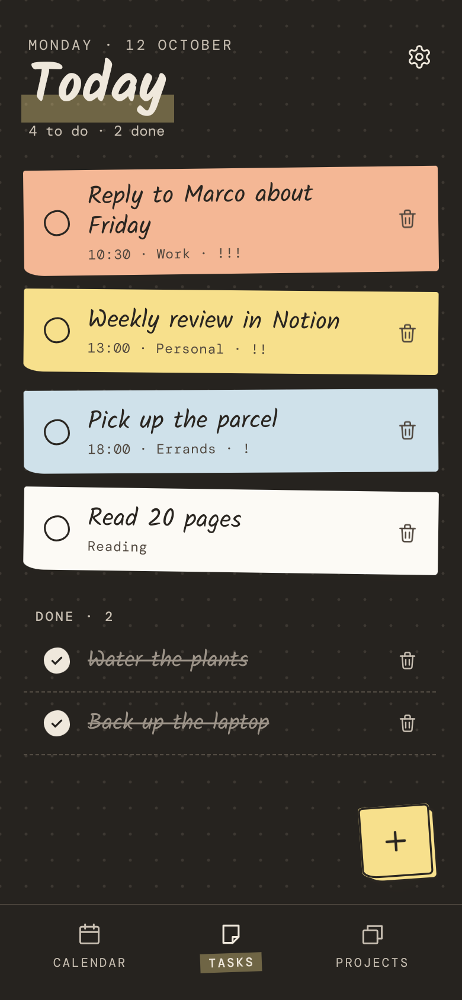
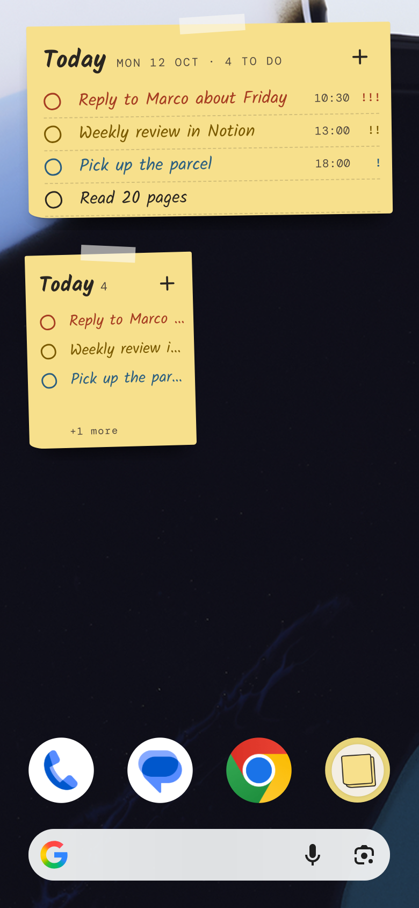
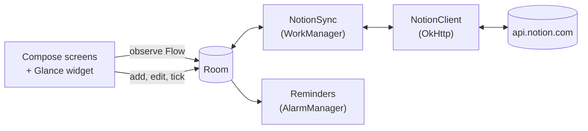

# StillNote

**A quiet to-do app for Android that syncs with Notion**

[](LICENSE)
[](gradle/libs.versions.toml)
[](app/build.gradle.kts)

<picture>
  <source media="(prefers-color-scheme: dark)" srcset="docs/images/made-for-notion-white.png">
  
</picture>

Write each task on a post-it, give it a day, a time and a priority, and tick it off when it's done.
The app looks like a dotted notebook page with few buttons on it. Your tasks live in a Notion database
of your own; StillNote keeps a copy on the phone so it works with no signal, and syncs both ways
whenever it can reach Notion. You can also use it without Notion and keep everything on the phone.

StillNote is not on Google Play. Download the APK from
[Releases](https://github.com/CristianPrincipi/StillNote/releases/latest), or build it from source
as described under [Setup](#setup).

## Screenshots

| Today | New task | Calendar | Projects | Night | Widget |
| :---: | :---: | :---: | :---: | :---: | :---: |
|  |  |  |  |  |  |

## Features

- **Today** is the home screen: today's open tasks as post-its, coloured by priority and marked `!`
  to `!!!`, so priority never relies on colour alone. Timed tasks come first, in time order. Tick a
  task off, delete it (with Undo), or tap it to edit. Done tasks are listed underneath.
- **The note**: the "+" pad opens a post-it to write a task on. Step the day and the time forward
  and back, or open the calendar and clock pickers; then set a priority and a project. A task with a
  project can have no date.
- **Calendar**: a month with each day's done and open tasks as small squares, and the chosen day's
  list underneath, where tasks can be ticked off or opened.
- **Projects**: one index card per project with its open tasks. A new project stays on the phone
  until its first task is saved, then it becomes an option in Notion.
- **Reminders**: every timed task reminds you 5 to 60 minutes before (10 by default, or its own in
  the clock picker). The notification has *Done*, *Later* and *Edit*. A morning list can show
  today's tasks that have no time, at a time you choose.
- **Home screen widget**: one resizable widget with today's tasks on a post-it. Tick a task off,
  open one, or add a new one without opening the app. At 4×2 it also shows each task's time and
  priority.
- **Two palettes and three fonts**: *Canary* (light) or *Night* (a dark page with the same paper
  notes), and your words in *Handwritten*, *Typewriter* or *Bookish* type.
- **Two-way Notion sync**, offline-first. Every change is saved on the phone immediately and sent to
  Notion afterwards; changes made in Notion are pulled down. Pull down on any tab to sync now.
- **Property mapping**: setup guesses which properties are the task name, done, date, priority and
  project, and you can change any of them. The mapping is stored by property ID, so renaming a
  column in Notion later does not break sync.
- **No Notion needed**: tasks can stay on the phone. If you connect later, they are copied into
  Notion.
- **No telemetry.** `api.notion.com` is the only host the app contacts.

The app is in English.

## Tech stack

| Concern | Choice |
| --- | --- |
| Language | Kotlin 2.4.21 |
| UI | Jetpack Compose (BOM 2026.09.00), Foundation only: no Material, every component is drawn as paper; the widget in Jetpack Glance 1.2.0 |
| Architecture | MVVM, single activity, unidirectional data flow |
| DI | None: `StillNoteApp` holds the long-lived objects and builds the ViewModels |
| Async | Coroutines, `Flow` / `StateFlow` |
| Local database | Room 2.8.5 (KSP), schemas exported to `app/schemas` |
| Preferences | DataStore 1.2.1 |
| Navigation | None needed: three tabs and their sheets in one root composable |
| Background work | WorkManager 2.12.0; `AlarmManager` for reminders |
| Networking | OkHttp 5.5.0 + kotlinx.serialization JSON |
| Dates | `java.time`, behind an injected clock |
| Build | Gradle 9.7.1 (Kotlin DSL, version catalog), Android Gradle Plugin 9.4.1 |
| Release | R8 with resource shrinking |
| Tests | JUnit 4 and MockWebServer on the JVM; instrumented tests on real SQLite; Python scripts that drive the app on an emulator against a fake Notion |
| Quality | Android Lint |

Every version is pinned in [`gradle/libs.versions.toml`](gradle/libs.versions.toml).

## Architecture



- **Room is the source of truth for the UI.** No screen waits on the network to render.
- **A change succeeds immediately and locally**, online or not, and is queued for `PushWorker`,
  which runs when there is a network and backs off exponentially. A tick sends only the checkbox, so
  it can't undo something changed in Notion meanwhile; an edit sends every field. A change Notion
  refuses shows *Couldn't save.* with *Retry*.
- **Pushes and pulls never overlap.** A pull asks Notion for the visible month by date, and for
  every task that has a project. While Notion is connected, `PullWorker` does the same with the app
  closed, every 15 minutes and just after midnight, so the widget doesn't wait for the app.
- **Requests are retried** when Notion answers `429` or `5xx`, after the delay Notion asks for. A
  new page is never sent twice after a server error, because the first one may have gone through.
- **The Notion API version is pinned** to `2026-03-11` (the data-sources API).
- **The token is encrypted with AES-256/GCM** under a key held in the Android Keystore, and stored
  as ciphertext in the app's private files. It leaves the device only as the `Authorization` header
  on a request to Notion and is never logged.
- **Reminders keep one alarm**, on the next reminder or morning list, and set it again after every
  change, a restart, an app update or a change of time zone. In its last 70 minutes it is an alarm
  clock (`setAlarmClock`): some phones, OnePlus's among them, let an ordinary exact alarm come up to
  an hour late. The rules are in `ReminderPlan`, which the JVM tests cover.

```
app/src/main/java/app/stillnote/
├─ data/            tasks, settings, the clock, connectivity
│  ├─ local/        Room database, entities, DAO
│  └─ notion/       the only package that touches the network: client, property mapping,
│                   sync, workers, token vault
├─ reminders/       the reminder rules, the alarm and the notifications
├─ ui/              the root composable, the ViewModel factory, sync status
│  ├─ today/  calendar/  projects/  newtask/  settings/  setup/
│  ├─ components/   paper, post-its, pickers, icons, pull-to-sync
│  └─ theme/        colours, palettes, fonts, shapes
└─ widget/          the Glance widget and the painter that draws it
design/             the design: spec, mockups as PNG and HTML, and their sources
tools/              Python scripts that drive the app on an emulator, and a fake Notion
```

## Design

The app is built to a design in [`design/`](design/): [`DESIGN.md`](design/DESIGN.md) holds the
tokens, components, screens and behaviour, and `design/screens/png/` the 19 mockups it is matched
against. [`CLAUDE.md`](CLAUDE.md) records the decisions made after the design, such as the task
order, the reminders and how the widget is drawn.

The widget is drawn as a single image with the app's own fonts, shapes and shadows, because
RemoteViews can't show bundled fonts or tilt. Invisible tap areas with labels sit over it.

## Requirements

- **Android Studio** recent enough to support Android Gradle Plugin 9.4.1
- **JDK 21** for Gradle; Android Studio's bundled JDK works. The code itself is compiled for Java 17.
- **Android SDK Platform 37** (`compileSdk` and `targetSdk` are 37)
- A device or emulator running **Android 8.0 (API 26)** or newer (`minSdk` is 26)
- A **Notion** account, if you want your tasks in Notion

Gradle 9.7.1 comes with the wrapper; you do not need to install it.

## Setup

### Install the app

Either download `StillNote-<version>.apk` from the
[latest release](https://github.com/CristianPrincipi/StillNote/releases/latest) and open it on your
phone (Android asks you to allow installs from your browser or file manager), or build it:

1. **Clone the repository.**

   ```bash
   git clone https://github.com/CristianPrincipi/StillNote.git
   ```

2. **Open it in Android Studio** and let Gradle sync. Android Studio writes `local.properties` with
   your SDK location; that file is gitignored.

3. **Build and run.**

   ```bash
   ./gradlew :app:installDebug
   ```

   A debug build is a separate app, *StillNote debug* (`app.stillnote.debug`), so it installs next
   to the release build instead of replacing it.

On first launch, *Use without Notion* keeps every task on the phone. You can connect Notion later in
*Settings*.

### Connect Notion

1. **Create a Notion token.** In Notion's developer portal, create a personal access token (Notion's
   current name for an internal integration token). It starts with `ntn_` (older ones with
   `secret_`), and Notion shows it only once, so copy it. The connection needs permission to read,
   update and insert content.

2. **Create the database**, or use one you have. StillNote needs a title, a checkbox and a date;
   a priority and a project are optional:

   | Property | Type | Required |
   | --- | --- | --- |
   | The task name (for example `Name`) | Title | Yes |
   | Done (for example `Done`) | Checkbox | Yes |
   | The day, with or without a time (for example `Date`) | Date | Yes |
   | Priority: `High`, `Medium`, `Low`, `None` | Select | No |
   | Project: one option per project | Select | No |

   The app guesses each property by its name, in English or Italian, and you can change its guess.
   What it reads and writes, and an example database, are in
   [`docs/notion-setup.md`](docs/notion-setup.md).

3. **Connect the token to the database.** In Notion, open the database → `•••` → *Connections*, and
   add your connection. A valid token cannot see a database until you do this.

4. **Paste the token in the app.** Choose *Connect Notion* on first launch, or *Settings → Connect*.
   StillNote checks the token, lists the databases it can see, and shows which property it picked
   for each field. The token is entered in the app only. It is never read from `local.properties`, a
   Gradle property or the build.

### Other builds

```bash
./gradlew :app:testDebugUnitTest          # JVM tests: Notion client, property mapping, reminder rules
./gradlew :app:connectedDebugAndroidTest  # the sync engine against real SQLite, on an emulator
./gradlew :app:lintDebug
./gradlew :app:assembleRelease            # minified release build
```

`connectedDebugAndroidTest` uninstalls the app when it finishes, and your Notion connection goes
with it. Run it on an emulator.

A release build is signed only if `keystore.properties` exists; copy
[`keystore.properties.template`](keystore.properties.template) and fill it in. Without it the release
APK is produced unsigned.

The scripts in [`tools/`](tools/) drive a debug build on an emulator (they need Python 3 and
Pillow): `screens.py` screenshots each screen and compares it with its mockup, `notion_e2e.py` runs
setup and sync against `fake_notion.py`, and `reminders_e2e.py` moves the emulator's clock to test
reminders. The last two wipe the app's data. [`CLAUDE.md`](CLAUDE.md) describes the emulator they
expect and the launch extras they use, such as `--ez demo true` for the sample tasks.

## Troubleshooting

| What you see | What Notion answered | Fix |
| --- | --- | --- |
| "Notion didn't accept this secret." or "Notion rejected this token" | `401` | The token is mistyped, incomplete or revoked. Create a new one and paste it in *Settings*. |
| "Nothing is shared with it yet." in the database list | – | The database is not shared with the connection. Open it in Notion → `•••` → *Connections*, then refresh the list. |
| "Not found · choose" next to a field | – | The app couldn't guess that property. Tap it and pick one, or add a property of that type in Notion. |
| "This database has no project field." | – | Add a *Select* property named `Project` in Notion, then pick it in *Settings → Change database or fields*. |
| "Couldn't save." with *Retry* | `400`, `403` or `404` | Notion refused a change: a mapped property was deleted or retyped, or the connection lost access to the database. Fix it in Notion or in *Settings → Change database or fields*, then *Retry*. |
| "Notion couldn't answer just now." or "couldn't sync" in the header | `429` or `5xx` | Usually nothing to do. The app waits for the delay Notion asks for and retries by itself; the message stays only if it is still failing. |
| "Couldn't reach Notion." or "offline" in the header | – | No connection. Tasks are kept on the phone and sent at the next sync. |
| "Notifications are off for StillNote" in *Settings* | – | Reminders can't show. Tap the link to Android's settings and allow notifications. |

## Roadmap

Not implemented yet:

- A page per project, for renaming, deleting or reordering projects; tapping a project card's header
  does nothing yet
- A *Status* property for done; only a checkbox works today
- Projects as a related database instead of a select
- Translations; only English ships
- Google Play. Reminders use `USE_EXACT_ALARM`, which Android grants without asking to an app
  installed by hand; Play would want `SCHEDULE_EXACT_ALARM` instead.
- Notion OAuth, so other people can connect without creating a token. That needs a token-exchange
  backend, because an OAuth client secret cannot be kept inside an APK.

Out of scope: accounts, a backend of our own, shared lists, paid tiers.

## Contributing

Issues and pull requests are welcome. Before opening a pull request, run:

```bash
./gradlew :app:lintDebug :app:testDebugUnitTest :app:assembleDebug
```

Tests never contact the live Notion API: the client is tested against MockWebServer, and the
scripts in `tools/` against a fake Notion. UI changes follow [`design/DESIGN.md`](design/DESIGN.md)
and its mockups; please open an issue before adding a screen or a button the design doesn't have.

StillNote is licensed under the GPL-3.0. By contributing you agree that your contribution is
licensed under the same terms, and anyone who distributes a modified version must release its
source under the GPL-3.0 as well.

## License

Copyright (C) 2026 Cristian Principi

This program is free software: you can redistribute it and/or modify it under the terms of the GNU
General Public License as published by the Free Software Foundation, version 3.

This program is distributed in the hope that it will be useful, but WITHOUT ANY WARRANTY; without
even the implied warranty of MERCHANTABILITY or FITNESS FOR A PARTICULAR PURPOSE. See the
[GNU General Public License](LICENSE) for more details.

Bundled third-party assets keep their own licences: see
[`docs/attributions.md`](docs/attributions.md). The "Made for Notion" badge is a Notion asset used
under Notion's brand guidelines and is not covered by this licence.

## Acknowledgements

- [Kalam](https://github.com/itfoundry/kalam), [Courier Prime](https://github.com/quoteunquoteapps/CourierPrime),
  [Newsreader](https://github.com/productiontype/Newsreader) and
  [DM Mono](https://github.com/googlefonts/dm-mono) (SIL Open Font License 1.1)
- Built with [Claude Code](https://claude.com/claude-code).

---

StillNote is an independent project and is not affiliated with, endorsed by, or sponsored by Notion Labs, Inc. Notion is a trademark of Notion Labs, Inc.
